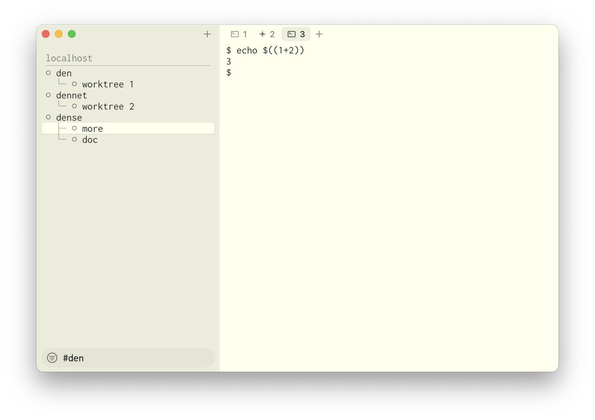

# dense

A macOS terminal whose shells keep running after you close them.



## Why

dense is a fork of [Ghostty](https://github.com/ghostty-org/ghostty), in the
spirit of [Superlogical's Rex](https://www.superlogical.com/): a sidebar of Spaces, each Space with its own
Surfaces (e.g. tabs), and every Surface's shell keeps running in the
background.

The difference: the job is split into three programs, so each one stays
small and the front end can be replaced without inventing a new protocol.

| program | job | |
|---|---|---|
| **dense** | the window | Native and fast (it is Ghostty). Draws the sidebar, the Surfaces and the terminal. Stores nothing. |
| [**dennet**](https://github.com/mkmik/dennet) | the state | The Kubernetes API server, cut down to one small binary on a Unix socket. Holds Spaces, Surfaces and Dens. Any front end, script or `kubectl` can read and change them. |
| [**den**](https://github.com/mkmik/den) | the process | Runs one program on its own PTY in the background, like [zmx](https://github.com/neurosnap/zmx). Detach, reattach, nothing lost. |

```
 ┌────────────────────────────────┐
 │ dense          the window      │
 └───────┬────────────────┬───────┘
         │ Spaces,        │ keys, screen
         │ Surfaces       │ (den attach)
         │ (watch, edit)  │
 ┌───────▼───────┐        │
 │ dennet        │        │
 │ the state     │        │
 └───────▲───────┘        │
         │ status         │
 ┌───────┴────────────────▼───────┐
 │ den            the process     │  one per Surface
 └────────────────────────────────┘
```

## Build

Needs Zig 0.17 and Xcode 26.

    zig build -Doptimize=ReleaseFast -Dxcframework-target=native
    open zig-out/Dense.app

dense has its own bundle ID (`pub.mkm.dense`), so it can be installed and
run alongside Ghostty. It needs dennet running at
`~/.local/state/dennet/dennet.sock`.

## Config

Same format as Ghostty, in `~/.config/dense/config.ghostty`. A Ghostty config
can be copied as is.

## Following Ghostty

dense's changes sit on top of a Ghostty release tag. To move to a new one:

    git fetch ghostty refs/tags/v1.5.0:refs/tags/ghostty-v1.5.0
    git merge ghostty-v1.5.0

Use a merge commit, never a squash, or every later merge conflicts.

## License

MIT, like Ghostty. See [LICENSE](LICENSE).
